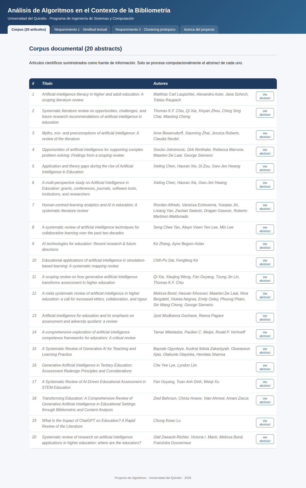

# Documento Técnico de Diseño

**Proyecto:** Análisis de algoritmos en el contexto de la bibliometría
**Institución:** Universidad del Quindío — Programa de Ingeniería de Sistemas y Computación
**Dominio de conocimiento:** Inteligencia Artificial Generativa en Educación (20 artículos científicos)

---

## 1. Introducción y alcance

Este documento describe el diseño, la arquitectura y el análisis algorítmico-matemático de la solución
implementada para el proyecto. El sistema procesa los **abstracts** de 20 artículos científicos suministrados
por el docente, y responde a dos requerimientos funcionales:

- **Requerimiento 1:** análisis de similitud textual entre pares de artículos, usando 4 algoritmos clásicos y
  2 algoritmos basados en Inteligencia Artificial.
- **Requerimiento 2:** agrupamiento jerárquico de los 20 abstracts usando 3 criterios de enlace distintos,
  representado como dendrograma, y evaluado con una métrica de coherencia interna.

De acuerdo con la nota del enunciado ("la presente descripción del proyecto puede ser modificada [...] en
particular con los requerimientos funcionales"), este documento cubre los requerimientos 1, 2 y 6
(despliegue + documentación) tal como estaban especificados al momento de desarrollar el proyecto. La
arquitectura se diseñó de forma modular (ver sección 2) para poder incorporar requerimientos adicionales sin
reescribir el sistema.

Todos los algoritmos de similitud y de clustering fueron **implementados explícitamente con estructuras
básicas del lenguaje** (arreglos, mapas, recursión), sin usar funciones de alto nivel de una librería que
resuelva directamente el problema, conforme lo exige el enunciado.

---

## 2. Arquitectura del sistema

### 2.1 Vista general

```
                     ┌─────────────────────────────┐
                     │   Navegador (frontend)       │
                     │  index.html + app.js + CSS   │
                     └───────────────┬───────────────┘
                                     │ HTTP / JSON
                     ┌───────────────▼───────────────┐
                     │   ServidorHttp (com.sun.net.  │
                     │   httpserver) — capa web/API  │
                     └───┬───────────────────────┬────┘
                         │                       │
            ┌────────────▼───────────┐  ┌────────▼─────────────┐
            │   MotorSimilitud        │  │   MotorClustering     │
            │  (Requerimiento 1)      │  │  (Requerimiento 2)    │
            └──────┬──────────┬───────┘  └──────────┬────────────┘
                   │          │                      │
      ┌────────────▼──┐   ┌───▼───────────┐   ┌──────▼─────────────┐
      │ similitud/     │   │ similitud/ia  │   │ clustering/         │
      │ clasico/       │   │ (embeddings)  │   │ (enlaces + evaluac.)│
      └────────────────┘   └───────────────┘   └─────────────────────┘
                   │                     │
            ┌──────▼─────────────────────▼──────┐
            │   texto/ (Preprocesador, Stemmer)   │
            └──────────────────┬───────────────────┘
                                │
                     ┌──────────▼───────────┐
                     │  datos/               │
                     │  RepositorioArticulos │
                     │  (carga data/articulos.json) │
                     └───────────────────────┘
```

### 2.2 Paquetes del código fuente (`app/src/main/java/co/edu/uniquindio/bibliometria/`)

| Paquete | Responsabilidad |
|---|---|
| `model` | Entidad de dominio `Articulo` (id, título, autores, abstract, tokens). |
| `datos` | `RepositorioArticulos`: carga y cachea el corpus desde `data/articulos.json`. |
| `texto` | `Preprocesador`, `Stemmer`, `ListaStopwords`: pipeline de preprocesamiento de texto. |
| `similitud` | `MotorSimilitud` (orquestador) y `ResultadoSimilitud` (DTO de resultado). |
| `similitud.clasico` | Los 4 algoritmos clásicos + `TfIdfVectorizador`. |
| `similitud.ia` | Los 2 algoritmos con IA + `RepositorioEmbeddings` + `VectorizadorEmbeddings`. |
| `clustering` | Algoritmo aglomerativo genérico, las 3 estrategias de enlace, dendrograma. |
| `clustering.evaluacion` | `CorrelacionCofenetica`: métrica de evaluación interna. |
| `web` | `ServidorHttp`: servidor HTTP, rutas de la API REST, archivos estáticos. |
| `util` | `JsonParser` / `JsonEscritor`: utilidades de lectura/escritura JSON propias. |

### 2.3 Decisión de arquitectura: aplicación Java sin framework externo

El backend se implementó como una aplicación Java 17 **sin dependencias externas**, usando
`com.sun.net.httpserver.HttpServer` (incluido en el JDK) en lugar de Spring Boot, y un parser/escritor JSON
propio en lugar de Jackson/Gson. La razón es práctica (el entorno de desarrollo no tenía acceso a Maven
Central para verificar la compilación con esas dependencias) pero también tiene una ventaja pedagógica: todo
el comportamiento de la aplicación —incluyendo la serialización de datos— es auditable y no depende de
"cajas negras". El `pom.xml` sigue siendo un proyecto Maven estándar y compila igualmente con
`mvn clean package` en cualquier entorno con acceso normal a internet. Esta decisión se declara también en
`docs/DECLARACION_USO_IA.md`.

---

## 3. Fuentes de datos y preprocesamiento

### 3.1 Extracción de metadatos (carpeta `extraction/`)

Los 20 PDFs (`recursos/articulos-originales/`) tienen formatos de columnas distintos según la editorial
(Elsevier, Springer, MDPI, Emerald, entre otras), lo que hace que la extracción automática de texto con
`pdftotext` desordene el abstract en varios casos (el texto de columnas adyacentes se intercala). El proceso
seguido fue:

1. Extracción de texto plano de cada PDF (`pdftotext`).
2. Heurística de localización del abstract (entre el encabezado "Abstract"/"A B S T R A C T" y el inicio de la
   sección "1. Introduction" o la lista de "Keywords").
3. **Revisión manual de los 20 resultados** contra el PDF original, con corrección explícita de los casos donde
   la heurística fallaba (columnas intercaladas, referencias bibliográficas insertadas a mitad de un
   párrafo, palabras partidas por guion de fin de línea).
4. Normalización de caracteres especiales (ligaduras tipográficas `fi`, `fl`; comillas tipográficas; guiones
   largos) a su forma ASCII equivalente.

El resultado (`extraction/articulos.json`, copiado como recurso de la aplicación en
`app/src/main/resources/data/articulos.json`) es la única fuente de datos que usa la aplicación en tiempo de
ejecución: no se re-procesan los PDFs en cada arranque, lo cual hace el comportamiento reproducible y evita
tener que empaquetar una librería de extracción de PDF dentro de la aplicación desplegada.

### 3.2 Preprocesamiento de texto (`texto.Preprocesador`)

Se implementaron **dos variantes** del pipeline de preprocesamiento, elegidas según lo que necesita cada
familia de algoritmos:

| Pipeline | Pasos | Usado por |
|---|---|---|
| `normalizarParaEdicion` | minúsculas, remoción de acentos (NFD), remoción de puntuación | Levenshtein |
| `procesarParaVectorial` | tokenizar → quitar stopwords → **stemming** (Porter simplificado) | Needleman-Wunsch (a nivel de tokens), TF-IDF/Coseno, Jaccard |
| `procesarParaEmbeddings` | tokenizar → quitar stopwords (**sin** stemming) | Similitud Coseno / Distancia Euclidiana sobre embeddings |

**Nota de diseño importante:** los algoritmos basados en embeddings usan tokens **sin stemming**, a
diferencia de TF-IDF/Jaccard. La razón es que el modelo de embeddings preentrenado (GloVe) tiene vectores para
palabras reales del idioma inglés ("literacy", "assessment"), pero no para raíces truncadas artificiales que
produce el stemmer ("literaci", "assess"). Aplicar stemming antes de la búsqueda en el vocabulario de
embeddings reduciría drásticamente la cantidad de palabras que logran encontrar su vector (en pruebas
tempranas del proyecto, la cobertura pasó de ~46% a **97%–100%** de las palabras del abstract al corregir este
detalle). Este es exactamente el tipo de matiz algorítmico que el proyecto pide analizar críticamente.

El **stemmer** (`texto.Stemmer`) es una implementación propia y simplificada del algoritmo de Porter (1980):
calcula la "medida" silábica (m) de una palabra a partir de su patrón de vocales/consonantes, y aplica reglas
de sufijos en 5 pasos sucesivos (por ejemplo, `"sses"→"ss"`, `"eed"→"ee"` si m>0, `"ational"→"ate"` si m>0,
etc.). No se usó ninguna librería de stemming (Snowball, Lucene Analyzer, etc.).

Las **stopwords** (`texto.ListaStopwords`) son una lista estática de ~180 palabras vacías del inglés (idioma
de los 20 abstracts), definida manualmente.

---

## 4. Requerimiento 1 — Análisis de Similitud Textual

### 4.1 Algoritmos clásicos

#### 4.1.1 Distancia de Levenshtein

Mide el número mínimo de inserciones, borrados y sustituciones de un carácter para transformar la cadena A en
la cadena B, mediante programación dinámica:

```
D[0][j] = j                                        (insertar j caracteres)
D[i][0] = i                                        (borrar i caracteres)
D[i][j] = D[i-1][j-1]                               si A[i] == B[j]
D[i][j] = 1 + min(D[i-1][j], D[i][j-1], D[i-1][j-1]) en otro caso
```

El resultado se normaliza como `similitud = 1 - distancia / max(|A|, |B|)`. Se aplica sobre el texto completo
normalizado (nivel de carácter), lo que lo hace muy sensible a diferencias de longitud y orden de palabras.

**Implementación:** `similitud.clasico.LevenshteinSimilitud`.

#### 4.1.2 Needleman-Wunsch

Algoritmo clásico de alineamiento global de secuencias (Needleman & Wunsch, 1970). A diferencia de
Levenshtein, aquí se aplica **a nivel de tokens/palabras** ya preprocesadas (tras tokenizar, quitar stopwords y
aplicar stemming), con un esquema de puntuación `match = +2`, `mismatch = -1`, `gap = -1`:

```
F[0][j] = j · gap
F[i][0] = i · gap
F[i][j] = max( F[i-1][j-1] + s(Ai,Bj),  F[i-1][j] + gap,  F[i][j-1] + gap )
```

Esta elección metodológica (carácter vs. token) es intencional: permite comparar en el análisis crítico
(sección 4.4) cómo la granularidad del algoritmo de alineamiento afecta el resultado.

**Implementación:** `similitud.clasico.NeedlemanWunschSimilitud`.

#### 4.1.3 Similitud del Coseno sobre TF-IDF

Cada abstract se representa como un vector disperso donde cada dimensión es un término del corpus, ponderado
por TF-IDF:

```
tf(t,d)  = ocurrencias(t,d) / |d|
idf(t)   = ln( (1+N) / (1+df(t)) ) + 1        (N = 20 documentos, df = documentos que contienen t)
tfidf(t,d) = tf(t,d) · idf(t)

cos(θ) = (A · B) / (||A|| · ||B||)
```

El IDF se calcula **una sola vez sobre los 20 abstracts completos** (no solo sobre el par seleccionado), para
que los pesos reflejen qué tan específico es un término en todo el corpus.

**Implementación:** `similitud.clasico.TfIdfVectorizador` + `CosenoTfIdfSimilitud`.

#### 4.1.4 Coeficiente de Jaccard

Cada abstract se representa como el **conjunto** de tokens distintos que contiene:

```
J(A,B) = |A ∩ B| / |A ∪ B|
```

**Implementación:** `similitud.clasico.JaccardSimilitud`.

### 4.2 Algoritmos basados en Inteligencia Artificial

Se usa un modelo de **embeddings preentrenado GloVe (100 dimensiones, Wikipedia + Gigaword)**, tal como lo
habilita explícitamente el enunciado del proyecto. Por restricciones del entorno de desarrollo (sin acceso a
Maven Central para incluir una librería Java de embeddings), el modelo se descargó una sola vez con la
librería Python `gensim` y se **filtró** para conservar solo las ~1000 palabras que efectivamente aparecen en
el corpus de 20 abstracts, generando un recurso de menos de 1 MB (`embeddings/glove100_filtrado.tsv`) en lugar
de los cientos de MB del modelo completo. Ese proceso de filtrado (`extraction/build_embeddings.py`) es
infraestructura de preparación de datos, no uno de los algoritmos exigidos por el curso.

Cada abstract se representa como el **promedio de los vectores de palabra** ("average word embeddings") de
sus tokens (sin stemming, ver sección 3.2):

```
V(documento) = (1/k) · Σ embedding(palabra_i)     para las k palabras del documento encontradas en GloVe
```

#### 4.2.1 Similitud del Coseno sobre embeddings

```
cos(θ) = (V_A · V_B) / (||V_A|| · ||V_B||)
```

**Implementación:** `similitud.ia.CosenoEmbeddingSimilitud`.

#### 4.2.2 Distancia Euclidiana sobre embeddings

```
dist(A,B) = sqrt( Σ (V_A,i - V_B,i)² )
similitud = 1 / (1 + dist)          (transformación para expresarlo en la misma escala [0,1] que los demás)
```

**Implementación:** `similitud.ia.EuclidianaEmbeddingSimilitud`.

El cálculo de la similitud/distancia sobre los vectores (producto punto, norma, suma de cuadrados) se
implementó manualmente con operaciones aritméticas básicas sobre arreglos `double[]`; no se usó ninguna
librería de álgebra lineal (Apache Commons Math, ND4J, etc.) para ese cálculo.

### 4.3 Caso de estudio (Requerimiento 1)

Se seleccionaron dos abstracts reales del corpus:

- **Artículo 1:** *"Artificial intelligence literacy in higher and adult education: A scoping literature
  review"* (Laupichler et al., 2022) — 97 tokens tras preprocesamiento.
- **Artículo 2:** *"Systematic literature review on opportunities, challenges, and future research
  recommendations of artificial intelligence in education"* (Chiu et al., 2023) — 70 tokens tras
  preprocesamiento.

#### 4.3.1 Ejemplo ilustrativo compacto del llenado de matrices

Antes de mostrar los resultados reales sobre los abstracts completos (varios miles de caracteres, cuya matriz
de programación dinámica sería demasiado grande para incluir en un documento), se ilustra el mecanismo interno
de cada algoritmo de programación dinámica con un ejemplo compacto.

**Levenshtein**, ejemplo clásico de la literatura, `"kitten"` vs `"sitting"`:

| | ∅ | s | i | t | t | i | n | g |
|---|---|---|---|---|---|---|---|---|
| **∅** | 0 | 1 | 2 | 3 | 4 | 5 | 6 | 7 |
| **k** | 1 | 1 | 2 | 3 | 4 | 5 | 6 | 7 |
| **i** | 2 | 2 | 1 | 2 | 3 | 4 | 5 | 6 |
| **t** | 3 | 3 | 2 | 1 | 2 | 3 | 4 | 5 |
| **t** | 4 | 4 | 3 | 2 | 1 | 2 | 3 | 4 |
| **e** | 5 | 5 | 4 | 3 | 2 | 2 | 3 | 4 |
| **n** | 6 | 6 | 5 | 4 | 3 | 3 | 2 | 3 |

Distancia final `D[6][7] = 3` (sustituir k→s, sustituir e→i, insertar g). Similitud = `1 - 3/max(6,7) = 0.5714`.

**Needleman-Wunsch**, a nivel de tokens preprocesados, comparando dos frases cortas y temáticamente
relacionadas con el artículo 1 ("AI literacy adult education" vs "AI literacy higher education"), con
`match=+2, mismatch=-1, gap=-1`:

Tokens A: `[ai, literaci, adult, educ]` — Tokens B: `[ai, literaci, higher, educ]`

| | ∅ | ai | literaci | higher | educ |
|---|---|---|---|---|---|
| **∅** | 0 | -1 | -2 | -3 | -4 |
| **ai** | -1 | 2 | 1 | 0 | -1 |
| **literaci** | -2 | 1 | 4 | 3 | 2 |
| **adult** | -3 | 0 | 3 | 3 | 2 |
| **educ** | -4 | -1 | 2 | 2 | 5 |

Puntaje final `F[4][4] = 5` (2 coincidencias exactas "ai" y "literaci" = +4, "educ" al final = +2, un
mismatch adult/higher = -1, sobre una diagonal favorable). Similitud normalizada = `0.75`.

#### 4.3.2 Resultados reales de los 6 algoritmos (artículo 1 vs. artículo 2)

Estos valores fueron generados **ejecutando la aplicación real** (`GET /api/similitud?idA=1&idB=2`), no
calculados a mano:

| Algoritmo | Similitud | Detalle relevante |
|---|---|---|
| Levenshtein (clásico) | **0.3206** | distancia = 767 caracteres, sobre longitudes 1129 y 887 |
| Needleman-Wunsch (clásico) | **0.1237** | puntaje de alineamiento = -61, sobre 97 y 70 tokens |
| Coseno TF-IDF (clásico) | **0.1992** | ángulo = 78.5°, producto punto = 0.0183 |
| Jaccard (clásico) | **0.1327** | intersección = 15 palabras, unión = 113 palabras |
| Coseno sobre embeddings (IA) | **0.9614** | ángulo = 15.97°, cobertura 97/97 y 64/70 palabras |
| Distancia Euclidiana sobre embeddings (IA) | **0.5242** | distancia euclidiana = 0.908 |

Palabras en común (Jaccard, tras stemming): `ai, artifici, content, current, educ, futur, identifi, intellig,
learn, literatur, relev, result, technologi, understand, us`.

Términos con mayor peso TF-IDF: en el artículo 1 destacan *adult* (0.104), *literaci* (0.091), *ai* (0.076); en
el artículo 2 destacan *ai* (0.105), *outcom* (0.076), *examin* (0.070) — coherente con que ambos abstracts
tratan IA en educación, pero el primero enfatiza la alfabetización de adultos y el segundo un mapeo sistemático
de oportunidades/desafíos.

### 4.4 Análisis crítico: clásicos vs. IA

El resultado más notable del caso de estudio es la **brecha grande** entre los algoritmos clásicos
(0.12–0.32) y los algoritmos de IA (0.52–0.96) para el **mismo par de artículos**. Esto no es un error: revela
una diferencia fundamental de qué es lo que cada familia de algoritmos realmente mide:

- Los algoritmos clásicos (Levenshtein, Needleman-Wunsch, Jaccard, TF-IDF) miden **coincidencia léxica
  literal**: cuentan caracteres o palabras que aparecen igual (o casi igual) en ambos textos. Dos abstracts
  pueden tratar exactamente el mismo tema con vocabulario distinto (sinónimos, paráfrasis) y aun así obtener
  una similitud clásica baja, como ocurre aquí: solo 15 de 113 palabras distintas son literalmente compartidas.
- Los algoritmos de IA (embeddings) miden **cercanía semántica**: el modelo GloV
e fue entrenado sobre un
  corpus masivo de texto y aprendió que palabras usadas en contextos similares (p. ej. "students",
  "teachers", "learning", "assessment") tienen vectores cercanos, aunque los dos abstracts no compartan esas
  palabras exactas. Por eso el coseno sobre embeddings (0.96) refleja mucho mejor la intuición humana de que
  "estos dos artículos sí tratan del mismo tema" (ambos son *revisiones de literatura sobre IA en educación*).
- Entre los dos algoritmos de IA, la **distancia euclidiana** (0.52) es notablemente más conservadora que el
  **coseno** (0.96). Esto es un efecto conocido: el coseno solo mide la *dirección* de los vectores promedio
  (ambos abstracts "apuntan" hacia el mismo vecindario semántico de "IA + educación"), mientras que la
  distancia euclidiana también penaliza diferencias en la *magnitud* del vector promedio, la cual depende de
  cuántas palabras específicas y poco frecuentes (con vectores de mayor norma) contiene cada abstract.
- Dentro de los algoritmos clásicos, Levenshtein (0.32) es mayor que Needleman-Wunsch (0.12) para este par,
  lo cual ilustra el efecto de la granularidad: a nivel de carácter, dos textos largos en inglés comparten
  muchísimos fragmentos cortos (espacios, terminaciones "-tion", "-ing", artículos "the", "of") aunque traten
  temas distintos, inflando la similitud de Levenshtein; a nivel de token completo, esas coincidencias
  parciales no cuentan, y el esquema de penalización por *gap* (palabras sin pareja) es más severo.

**Conclusión del caso de estudio:** para esta tarea (encontrar artículos temáticamente relacionados dentro de
una revisión bibliográfica), los algoritmos de IA capturan mejor la similitud "real" que percibiría un
investigador humano, mientras que los algoritmos clásicos son más útiles para detectar **coincidencia textual
literal** (por ejemplo, para detectar plagio o abstracts casi duplicados), que es un problema distinto.

---

## 5. Requerimiento 2 — Agrupamiento Jerárquico

### 5.1 Preprocesamiento y matriz de distancias

Se reutiliza el mismo pipeline de TF-IDF del Requerimiento 1 sobre los 20 abstracts, y se construye una matriz
de distancias 20×20 con `distancia = 1 - similitud_coseno(TF-IDF)` (`clustering.DistanciaCorpus`). Se eligió
esta métrica como punto de partida porque ya estaba validada en el Requerimiento 1 y produce una noción de
distancia clásica y determinística (no dependiente de una red neuronal), apropiada como línea base para el
clustering.

### 5.2 Algoritmo aglomerativo genérico (fórmulas de Lance-Williams)

Se implementó un único algoritmo aglomerativo (`clustering.ClusteringJerarquico`) que parte de 20 clusteres
unitarios y, en cada iteración, fusiona el par con menor distancia, actualizando las distancias del nuevo
cluster hacia los demás mediante la fórmula de Lance-Williams correspondiente a cada criterio de enlace
(estrategia `EstrategiaEnlace`, patrón *Strategy*):

| Enlace | Fórmula de actualización | Clase |
|---|---|---|
| **Single Linkage** | `d(I∪J, M) = min(d(I,M), d(J,M))` | `EnlaceSimple` |
| **Complete Linkage** | `d(I∪J, M) = max(d(I,M), d(J,M))` | `EnlaceCompleto` |
| **Average Linkage (UPGMA)** | `d(I∪J, M) = (\|I\|·d(I,M) + \|J\|·d(J,M)) / (\|I\|+\|J\|)` | `EnlacePromedio` |

El resultado de cada ejecución es un **dendrograma** (`NodoDendrograma`): árbol binario donde cada hoja es un
artículo y cada nodo interno registra la altura (distancia) a la que se fusionaron sus dos subárboles.

### 5.3 Visualización (dendrogramas)

La aplicación web dibuja los 3 dendrogramas con SVG generado dinámicamente en el navegador
(`app.js::construirSvgDendrograma`), a partir del árbol JSON devuelto por `GET /api/clustering`. Cada hoja se
etiqueta con el id y el título abreviado del artículo.




### 5.4 Evaluación interna: Coeficiente de Correlación Cofenética

Para determinar cuál de los 3 algoritmos produce el agrupamiento más coherente, se implementó el
**Coeficiente de Correlación Cofenética** (Sokal & Rohlf, 1962):

1. La **distancia cofenética** entre dos artículos i, j es la altura a la que el dendrograma los fusiona por
   primera vez en un mismo cluster (`CorrelacionCofenetica.calcularMatrizCofenetica`, recorrido recursivo del
   árbol).
2. La **correlación cofenética** es el coeficiente de correlación de Pearson (implementado manualmente, sin
   Apache Commons Math) entre las distancias originales (matriz TF-IDF) y las distancias cofenéticas, tomando
   el triángulo superior de ambas matrices (190 pares para 20 artículos).

Un valor cercano a 1 indica que el dendrograma preserva fielmente las distancias originales.

**Resultados reales** (`GET /api/clustering`, ejecutado sobre los 20 abstracts):

| Algoritmo de enlace | Correlación cofenética |
|---|---|
| Single Linkage | 0.7487 |
| Complete Linkage | 0.5717 |
| **Average Linkage (UPGMA)** | **0.8021** ← más coherente |

**Interpretación:** Average Linkage produce el agrupamiento más coherente con las distancias TF-IDF
originales. Esto es consistente con la teoría: Single Linkage es propenso al "efecto de encadenamiento"
(*chaining*) — tiende a ir anexando artículos uno por uno a un cluster grande en lugar de formar grupos
temáticos claros, lo que distorsiona las distancias cofenéticas para los primeros artículos en encadenarse.
Complete Linkage, en el extremo opuesto, fuerza clusters muy compactos y homogéneos en tamaño, lo cual también
distorsiona las distancias cuando el corpus no tiene una estructura de clusters perfectamente balanceada — de
hecho obtuvo aquí la correlación más baja. Average Linkage, al promediar (ponderado por tamaño) las
distancias entre todos los pares de artículos de los dos clusters que se fusionan, es un balance intermedio
que en la práctica suele ajustarse mejor a corpus de texto con estructura temática difusa, como es el caso de
20 revisiones de literatura sobre un dominio relacionado (IA en educación) donde los límites entre subtemas
(alfabetización en IA, evaluación educativa, aprendizaje colaborativo, ChatGPT, etc.) no son tajantes.

---

## 6. Aplicación web

La interfaz web (`app/src/main/resources/static/`) es una aplicación de una sola página (HTML + CSS + JS
vainilla, sin frameworks ni CDN) con 4 secciones:

1. **Corpus:** tabla de los 20 artículos con acceso al abstract completo.
2. **Requerimiento 1:** selección dinámica de dos artículos (tal como exige el enunciado) y comparación con
   los 6 algoritmos, mostrando tanto el puntaje como el detalle matemático del cálculo (matriz, ángulo,
   términos con mayor peso, palabras en común, según el algoritmo).
3. **Requerimiento 2:** tabla comparativa de correlación cofenética de los 3 algoritmos, con el más coherente
   resaltado, y visualización interactiva de cada dendrograma.
4. **Acerca del proyecto:** resumen de la solución y enlaces al repositorio.

La API REST que consume el frontend:

| Endpoint | Descripción |
|---|---|
| `GET /api/articulos` | Lista los 20 artículos (metadatos + abstract). |
| `GET /api/articulos/{id}` | Un artículo específico. |
| `GET /api/similitud?idA=&idB=` | Ejecuta los 6 algoritmos de similitud sobre el par indicado. |
| `GET /api/clustering` | Ejecuta los 3 algoritmos de clustering y su evaluación cofenética. |

---

## 7. Pruebas de verificación

Se implementó una batería de pruebas manuales (`app/src/test/java/.../PruebasAlgoritmos.java`, sin JUnit por
la misma razón declarada en la sección 2.3) que compara la salida de cada algoritmo contra casos de referencia
matemáticamente conocidos: distancia de Levenshtein("kitten","sitting")=3, similitud de un texto consigo mismo
= 1.0 en los 4 algoritmos aplicables, Jaccard = 0 para conjuntos disjuntos, y una prueba de clustering sobre 4
puntos sintéticos con estructura de 2 pares claramente separados, verificando que el algoritmo los fusiona en
el orden correcto y que la correlación cofenética resultante es alta (>0.9). Las 17 aserciones pasan
(ver `README.md` para el comando de ejecución).

---

## 8. Despliegue

La aplicación se empaqueta como una imagen Docker (`app/Dockerfile`, build multi-etapa: Maven + JDK para
compilar, JRE liviano para ejecutar) y puede desplegarse en cualquier plataforma que soporte contenedores
(Render, Railway, Fly.io, un VPS propio, etc.). Instrucciones detalladas paso a paso en el `README.md` del
repositorio y en el propio `Dockerfile` (comentado).

Resumen rápido para Render.com:
1. Conectar el repositorio de GitHub (rama `main`).
2. Crear un "Web Service" nuevo, entorno Docker, root directory `app/`.
3. Render detecta el `Dockerfile` automáticamente y expone el puerto vía la variable de entorno `PORT`
   (ya soportada por `BibliometriaApplication`).

---

## 9. Limitaciones y trabajo futuro

- La extracción de metadatos de los PDFs es semi-automática (requirió corrección manual); un trabajo futuro
  podría mejorar la heurística de segmentación de columnas.
- El modelo de embeddings (GloVe 100d) es relativamente simple comparado con modelos de lenguaje modernos
  (BERT, embeddings de LLMs vía API); se eligió por ser reproducible offline y no depender de una API externa
  de pago para el despliegue.
- La arquitectura modular (interfaces `EstrategiaEnlace`, clases independientes por algoritmo) está preparada
  para incorporar requerimientos adicionales (por ejemplo, búsqueda por autor/título, mencionada en el
  enunciado como posible extensión futura) sin modificar el código existente.

---

## 10. Referencias

- Levenshtein, V. I. (1966). Binary codes capable of correcting deletions, insertions, and reversals.
- Needleman, S. B., & Wunsch, C. D. (1970). A general method applicable to the search for similarities in the
  amino acid sequence of two proteins. *Journal of Molecular Biology*.
- Porter, M. F. (1980). An algorithm for suffix stripping. *Program*, 14(3), 130-137.
- Salton, G., & McGill, M. J. (1983). *Introduction to Modern Information Retrieval* (TF-IDF).
- Jaccard, P. (1912). The distribution of the flora in the alpine zone.
- Lance, G. N., & Williams, W. T. (1967). A general theory of classificatory sorting strategies.
- Sokal, R. R., & Rohlf, F. J. (1962). The comparison of dendrograms by objective methods. *Taxon*, 11(2).
- Pennington, J., Socher, R., & Manning, C. D. (2014). GloVe: Global Vectors for Word Representation.
- Los 20 artículos científicos del corpus (ver `recursos/articulos-originales/` y las referencias completas
  embebidas como metadato `autores`/`titulo` en `extraction/articulos.json`).
